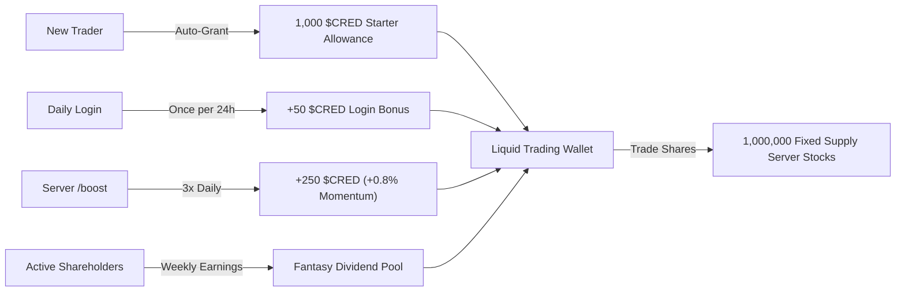
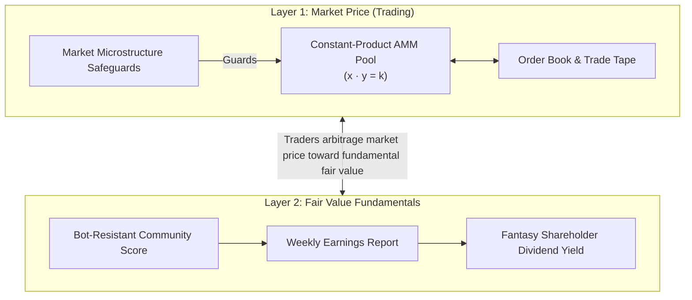
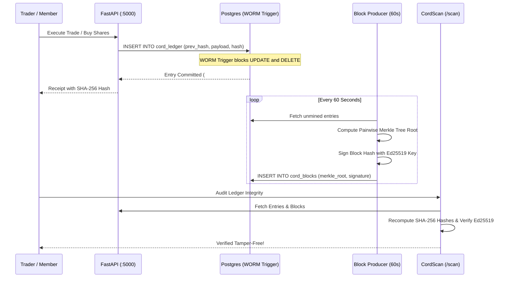

# CordChain: The Discord Community Stock Exchange & CordLedger Economy

> **CordChain** transforms Discord communities into publicly tradable community stocks backed by verified engagement metrics, constant-product AMM liquidity, weekly fantasy earnings reports, and a tamper-evident, append-only **CordLedger**.

---

## 1. Executive Summary & Architectural Paradigm Shift

Discord communities are vibrant digital nations with tens of thousands of passionate members, but traditional social platforms offer no transparent, competitive mechanism to measure community momentum or let members invest in communities they believe in.

CordChain introduces a **cross-server fantasy stock exchange**:
- Every Discord community can tokenize into an official stock ticker (e.g., `$CORDC`, `$SQUAD`, `$DEV`).
- **Traders and Members** trade shares on a live exchange floor featuring candlestick charts, order books, and automated market makers (AMMs).
- **Server Owners** receive an equity stake with ledger-enforced monthly vesting, incentivizing organic community growth.
- **Active Members** boost their community's stock, complete collaborative quests, and receive weekly fantasy dividend payouts in `$CRED`.

```mermaid
flowchart TD
    subgraph Discord["Discord Community Ecosystem"]
        A["Discord Server Community"] -->|Organic Chat & Voice| B["Bot-Resistant Community Score"]
        B -->|Weekly Earnings Report| C["Shareholder Dividends ($CRED)"]
        A -->|Daily Attention Check| D["Daily Boost (+250 $CRED)"]
    end

    subgraph Exchange["CordChain Market Engine"]
        E["Constant-Product AMM Pool<br>(x · y = k)"] <-->|Instant Trading| F["Live Trading Floor<br>Candles · Order Book"]
        C --> F
        D --> F
    end

    subgraph Ledger["CordLedger (Cryptographic Floor)"]
        F -->|Record Every Event| G["Append-Only Hash Chain<br>(SHA-256 prev_hash)"]
        G -->|1-Minute Blocks| H["Merkle Tree Blocks<br>+ Ed25519 Signatures"]
        H -->|Public Audit| I["CordScan Explorer<br>& CLI Verifier"]
    end
```



### Why We Dropped the Blockchain for "CordLedger"
Earlier prototypes used external Ethereum Layer-2 testnets (Base Sepolia). While transparent, blockchains introduced severe friction for a game: crypto wallet popups (MetaMask), testnet faucet delays, gas token requirements, and mobile connectivity hurdles.

CordChain replaces external blockchains with **CordLedger**:
1. **Zero Friction:** No MetaMask, no gas fees, no wallet extensions, no seed phrases. Instant 1-click execution.
2. **Mathematical Tamper-Evidence:** Every transaction is chained via SHA-256 hashes (`prev_hash`) and grouped into 1-minute blocks sealed with pairwise Merkle roots and signed with an Ed25519 server private key.
3. **Public Explorer & Verifier:** BaseScan is replaced by **CordScan** (a built-in web explorer at `/scan`) and an open-source CLI verifier script ([`scripts/verify_cordchain.py`](file:///home/runner/workspace/scripts/verify_cordchain.py)).

> [!NOTE]
> **Tamper-Evident, Not Trustless:** Because the platform runs the server, CordLedger is mathematically *tamper-evident*, not *tamper-proof*. If historical records were ever secretly altered, every downstream hash, Merkle root, and Ed25519 signature would instantly break.

---

## 2. The Simplified Fantasy Economy ($CRED Only)

CordChain operates on a single, unified fantasy currency: **`$CRED`**. All real-money fiat (`₹ INR`, `USD`), AdSense paywalls, and bank/UPI cashouts have been removed.



### Economic Rules
1. **Starter Allowance:** Every user automatically receives **1,000 $CRED** on their first visit, logged as an `ALLOWANCE` event on the CordLedger.
2. **Daily Login Bonus:** Users can claim **+50 $CRED** once every calendar day through the web vault or Discord bot (`POST /api/wallet/claim-allowance`).
3. **Daily Earn Cap:** Daily boost earnings are capped at **250 $CRED** across all servers to prevent grinding alts from dominating markets.
4. **Standardized Fixed Supply:** Every listed server has exactly **1,000,000 shares**. This makes market capitalization (`Price × 1,000,000`) directly comparable across all communities.
5. **Balanced Reserve Split & Ledger-Enforced Vesting:**
   - **75% Public Float (750,000 shares):** Seeded directly into the constant-product AMM pool for liquid trading.
   - **25% Creator Reserve (250,000 shares):**
     - 50,000 shares (5%) unlocked immediately at IPO.
     - 200,000 shares (20%) locked under a 30-day time lock: releases 50,000 shares (5%) per month via `POST /api/guilds/{id}/vesting-unlock`, appending a `VESTING_UNLOCK` record to the CordLedger.

---

## 3. Two-Layer Pricing & Market Defenses

Stock valuations combine real-time market trading with weekly fundamental earnings:



### Layer 1: Market Price (AMM Trading)
Every server stock is paired with `$CRED` in a constant-product automated market maker ($x \cdot y = k$):
- **Spot Price Formula:**
  $$\text{Spot Price} = \frac{\text{Pool CRED}}{\text{Pool Shares}}$$
- When users buy, shares leave the pool and `$CRED` enters, raising the spot price.
- When users sell, shares re-enter the pool and `$CRED` is paid out, lowering the spot price.
- This ensures even micro-servers always have instant liquidity to trade against without waiting for peer matching.

### Layer 2: Fair Value Fundamentals (Fantasy Dividends)
Every week, each community's **Community Score** is translated into a fantasy `$CRED` payout pool distributed pro-rata to shareholders ([`calculate_weekly_earnings`](file:///home/runner/workspace/cordchain/pricing.py#L183-L205)):
$$\text{Total Payout} = \text{Community Score} \times \text{Base League Rate}$$
$$\text{Annual Payout per Share} = \left(\frac{\text{Total Payout}}{\text{Circulating Shares}}\right) \times 52$$
$$\text{Implied Fair Value} = \frac{\text{Annual Payout per Share}}{0.10 \text{ (10% Capitalization Rate)}}$$
Traders research server activity to identify undervalued communities trading below their fundamental dividend yields.

### Market Microstructure Safeguards
To prevent market manipulation and flash-loan-style exploits, the matching engine enforces three defense layers:
- **Circuit Breaker ([`check_circuit_breaker`](file:///home/runner/workspace/cordchain/pricing.py#L78)):** A price swing $\ge 20\%$ in a 15-minute window automatically pauses trading for 30 minutes, allowing markets to cool down.
- **Position Concentration Limit ([`check_position_limit`](file:///home/runner/workspace/cordchain/pricing.py#L138)):** An individual account can hold at most **10% of total supply** (100,000 shares) to prevent hostile takeovers or cornering the float.
- **Wash-Trade Protection ([`check_wash_trade`](file:///home/runner/workspace/cordchain/pricing.py#L154)):** Rapid round-trip buy/sell flips executed within **60 seconds** are rejected to prevent self-dealing price manipulation.

---

## 4. Bot-Resistant Community Score & Anti-Cheat

Raw message counts can be easily botted. CordChain implements a cheat-resistant formulation in [`cordchain/anti_cheat.py`](file:///home/runner/workspace/cordchain/anti_cheat.py):

$$\text{Community Score} = \left(\sqrt{\text{Unique Chatters}} \times 12 \times W_{\text{spread}} \times W_{\text{retention}} \times (1 + B_{\text{growth}}) + B_{\text{voice}}\right) \times \text{Age Factor}$$

| Signal | Mathematical Implementation | Anti-Cheat Purpose |
| :--- | :--- | :--- |
| **Unique Active Chatters** | Scaled via $\sqrt{N}$; capped at 25 msgs/user/day | Prevents one spammer from flooding 5,000 messages. |
| **Conversation Spread ($W_{\text{spread}}$)** | Normalized Shannon entropy across the message distribution | 10 users chatting equally yields max entropy (1.0); 2 users dominating yields low entropy (<0.3). |
| **Retention Rate ($W_{\text{retention}}$)** | $\frac{\text{Returning Chatters Last Week}}{\text{Active Chatters Last Week}}$ | Rewards sticky, habitual communities over one-off raid spikes. |
| **Voice Minutes ($B_{\text{voice}}$)** | Scaled via $\sqrt{\text{Voice Minutes}} \times 0.4$ | Authentic voice participation proves real human engagement. |
| **Snowflake Age Factor** | Discord Snowflake decoding: accounts $<14$ days penalized | Disarms burner alt-account farms. |
| **Growth vs. Baseline ($B_{\text{growth}}$)** | $\text{Growth} = \frac{\text{Current Engagement}}{\text{7-Day Rolling Baseline}}$ | **Fairness piece:** A 200-member server doubling activity can beat a stagnant 100,000-member server. |

### League Size Brackets
Servers compete only against peer communities in their bracket:
- 🥉 **Bronze League:** 15 to 200 members ($C = 25$, Base Payout: $25.0$).
- 🥈 **Silver League:** 201 to 2,000 members ($C = 100$, Base Payout: $60.0$).
- 🥇 **Gold League:** 2,001+ members ($C = 500$, Base Payout: $150.0$).

### Strict Privacy Guarantee
CordChain never inspects, collects, or stores message content. All metrics operate on SHA-256 hashed Discord user IDs (`hash_discord_id`) and aggregate integer counts.

---

## 5. The CordLedger Engine & Verification

CordLedger is an append-only, cryptographic data ledger that records every significant platform state change.



### Key Components
1. **Append-Only Hash Chain ([`cordchain/ledger.py`](file:///home/runner/workspace/cordchain/ledger.py)):**
   - Each row includes `entry_index`, `ts`, `event_type`, `guild_id`, `user_id`, `payload`, `prev_hash`, and `hash`.
   - The SHA-256 entry hash is computed canonically:
     $$\text{Hash} = \text{SHA256}(\text{CanonicalJSON}(\{\text{id}, \text{ts}, \text{type}, \text{guild\_id}, \text{user\_id}, \text{payload}, \text{prev\_hash}\}))$$
2. **Postgres WORM Guard:**
   - A PostgreSQL trigger (`trg_cord_ledger_worm`) prevents any `UPDATE` or `DELETE` on the ledger table.
3. **1-Minute Block Producer:**
   - An asynchronous loop in [`cordchain/api.py`](file:///home/runner/workspace/cordchain/api.py) batches unmined entries every 60 seconds into a sealed block.
   - Computes a pairwise SHA-256 Merkle root across all block transaction hashes.
   - Signs the block hash using the platform's Ed25519 private key.
4. **CordScan Web Explorer ([`CordScanView.tsx`](file:///home/runner/workspace/artifacts/cordchain-ui/src/components/CordScanView.tsx)):**
   - Accessible at `/scan` in the web terminal.
   - Displays real-time block heights, transaction receipts, token pages, and an in-browser audit button (`verifyLedgerInBrowser()`).
5. **Cryptographic Verifier CLI ([`scripts/verify_cordchain.py`](file:///home/runner/workspace/scripts/verify_cordchain.py)):**
   - Independent Python script that audits entry hashes, checks unbroken `prev_hash` chaining, recalculates Merkle roots, and verifies Ed25519 digital signatures.

---

## 6. Discord-Native Social Mechanics

Most of CordChain's magic is embedded directly into Discord:

### 1. Weekly Earnings Reports (`/earnings`)
Every Sunday, server owners and shareholders can run `/earnings` or inspect automated announcements. The embed outlines the weekly Community Score, the total `$CRED` distributed to shareholders, and the canonical CordLedger transaction index.

### 2. Seasons & Hall of Fame (`/seasons`)
Competitions run on **30-day seasons**. At the end of each season, trader portfolios reset to preserve fair competition for new entrants, while top servers in Bronze, Silver, and Gold leagues are permanently enshrined in the Hall of Fame.

### 3. Server vs. Server Rivalries (`/rivalry`)
Communities can be paired in weekly derby matchups. Derbies reward the community with the highest organic growth rate over 7 days with a `$CRED` prize pool, allowing small energetic servers to conquer large dormant ones.

### 4. Collaborative Community Quests (`/quests`)
Servers receive weekly collaborative quests (e.g., *"Reach 50 unique chatters this week"* or *"Hold 120 voice minutes"*). Completing quests awards bonus points to the server's Community Score, directly inflating the dividend pool.

### 5. Event Prediction Markets (`/predictions`)
Members can wager fantasy `$CRED` on community events, derby outcomes, and chat growth targets using peer-to-peer liquidity pools.

### 6. Serious Deep-Ink Embed Style (`#252429`)
All Discord embeds use the signature **#252429 deep-ink aesthetic** with clean monospace data blocks, explicit `$CRED` denominations, and CordLedger receipts.

---

## 7. Complete Discord Bot Command Reference

The bot client runs a Pokétwo-style AutoSharded architecture with 24 hybrid commands (usable as slash `/` or prefix `!`):

| Category | Command | Description |
| :--- | :--- | :--- |
| **Trading** | `/buy <ticker> <shares>` | Buy shares of a listed server using liquid `$CRED`. |
| | `/sell <ticker> <shares>` | Sell shares back to the constant-product AMM pool. |
| | `/quote <ticker> <shares>` | View instant execution cost, price per share, and slippage. |
| **Market Data** | `/server [ticker]` | Open the detailed market overview for a community stock. |
| | `/servers [search]` | Browse the full directory of listed community stocks. |
| | `/orderbook [ticker]` | View the live AMM ladder and bid/ask depth. |
| | `/tape [ticker]` | Inspect the executed trade tape with CordLedger links. |
| | `/candle [ticker]` | View ASCII candlestick sparklines and 24h high/lows. |
| **Portfolio** | `/portfolio` (or `/bal`) | Inspect your fantasy net worth, liquid `$CRED`, and stock equity. |
| | `/leaderboard traders` | View top traders ranked by total portfolio net worth. |
| | `/leaderboard servers` | View top servers ranked by 24h market-cap gains. |
| **Growth & Score**| `/boost` (or `/checkin`) | Initiate 12s attention check (+250 $CRED, +0.8% price momentum). |
| | `/bump` | Bump server stock price (+0.4% momentum, requires holding $\ge 1$ share). |
| | `/bumpstatus` | Check your per-user bump cooldown timer. |
| | `/activity` | View live active chatters and hourly engagement metrics. |
| | `/earnings [ticker]` | View weekly Community Score and shareholder fantasy dividends. |
| **Social** | `/quests [ticker]` | View active collaborative objectives boosting server score. |
| | `/seasons` | View 30-day season calendar and Hall of Fame records. |
| | `/rivalry` | View active server vs server community derbies. |
| | `/predictions [ticker]`| View open prediction markets and wagering odds. |
| **Ledger & Admin**| `/verify` | Run real-time cryptographic audit of the CordLedger. |
| | `/tokenize` | Launch interactive wizard to tokenize an owned Discord server. |
| | `/ping` | Check bot latency and gateway heartbeat. |
| | `/shards` | View Discord gateway shard cluster status. |
| | `/help [topic]` | Interactive multi-category help desk. |

---

## 8. Web Trading Terminal Overview

The web trading terminal ([`artifacts/cordchain-ui`](file:///home/runner/workspace/artifacts/cordchain-ui)) is built with React 19, Vite 8, and Tailwind 4:

1. **Top Bar:** Live clock, API status indicator, liquid `$CRED` balance chip, and quick-nav to CordScan and Tokenize.
2. **Dashboard (`/`):** Market gainers carousel, featured communities, server listings, and quick-boost cards.
3. **Exchange (`/exchange`):** Live candlestick charts, real-time constant-product order books, buy/sell tickets with slippage estimates, and trade feeds.
4. **CordScan (`/scan`):** Public ledger explorer with block inspector, Merkle roots, Ed25519 signature validator, and transaction search.
5. **Manage Server Stocks (`/manage`):** Founder dashboard for verified Discord owners to manage liquidity reserves, monitor vesting schedules, and generate invite embeds.
6. **Portfolio (`/portfolio`):** Holdings breakdown, average buy price tracking, unrealized PnL, and transaction logs.
7. **Action Modals:**
   - **Attention Check Modal:** 12-second sponsor view + randomized 3-option context quiz (proof of human attention).
   - **Tokenize Server Modal:** 1-click CordLedger stock issuance enforcing Discord owner authorization and 1,000,000 fixed share distribution.
   - **Daily Allowance Modal:** 1-click claim for the +50 `$CRED` daily login bonus.

---

## 9. Runbook & Service Operations

All runtime components run locally in the workspace:

```bash
# 1. Start the Python FastAPI backend on port 5000
./run_api.sh

# 2. Start the Pokétwo-style AutoSharded Discord bot
./run_bot.sh

# 3. Start the Web Trading Terminal on port 3000
./run_web.sh

# 4. Seed database with initial leagues, demo servers, and spotlight cards
.venv/bin/python3 -m cordchain.seed

# 5. Run independent cryptographic audit on the running CordLedger
.venv/bin/python3 scripts/verify_cordchain.py --api http://localhost:5000
```

### Environment Configuration
- `DATABASE_URL`: PostgreSQL connection string (pooled via `pg8000`).
- `TOKEN` / `DISCORD_TOKEN`: Discord Bot Token with message content & guild member intents.
- `DISCORD_CLIENT_ID` / `DISCORD_CLIENT_SECRET`: OAuth2 application credentials for owner verification.
- `VITE_API_URL`: Backend URL for the web terminal (defaults to `http://localhost:5000`).
- `CORDCHAIN_SERVER_SEED`: Deterministic seed deriving the server's Ed25519 block signing key.

---

## 10. Architectural Comparison: Traditional Web3 vs. CordChain

| Dimension | Speculative Web3 Tokens | Legacy CordChain (Base Sepolia) | Modern CordChain (CordLedger) |
| :--- | :--- | :--- | :--- |
| **Currency** | Speculative volatile crypto | Dual currency ($CRED + ₹ INR) | **100% Fantasy `$CRED`** |
| **Wallets** | MetaMask, seed phrases | Injected Web3 / WalletConnect | **Zero Wallets** (Discord OAuth & browser vault) |
| **Gas Fees** | High / variable gas | Testnet gas (~0.0001 ETH) | **Zero Gas** (Instant internal matching) |
| **Trust Model** | Decentralized consensus | Decentralized testnet | **Tamper-Evident Local Ledger** (Merkle + Ed25519) |
| **Transparency** | Block explorers (Etherscan) | BaseScan | **CordScan Explorer** + CLI verifier |
| **Valuation Basis** | Pure hype & pump-and-dump | Ad revenue clicks | **Two-Layer:** AMM Spot + Fundamental Earnings |
| **Gaming Guard** | Minimal on-chain defense | Snowflake age check | **5-Layer Defense Matrix** (Entropy, Retention, Age, Circuit Breakers) |
| **Discord Native** | External dApps | Iframe embedded app | **Fully Integrated:** Bot cogs, derbies, quests, & web app |

---

*CordChain unites competitive gaming, community engagement, and transparent cryptographic accounting into a Discord-native fantasy exchange.*
